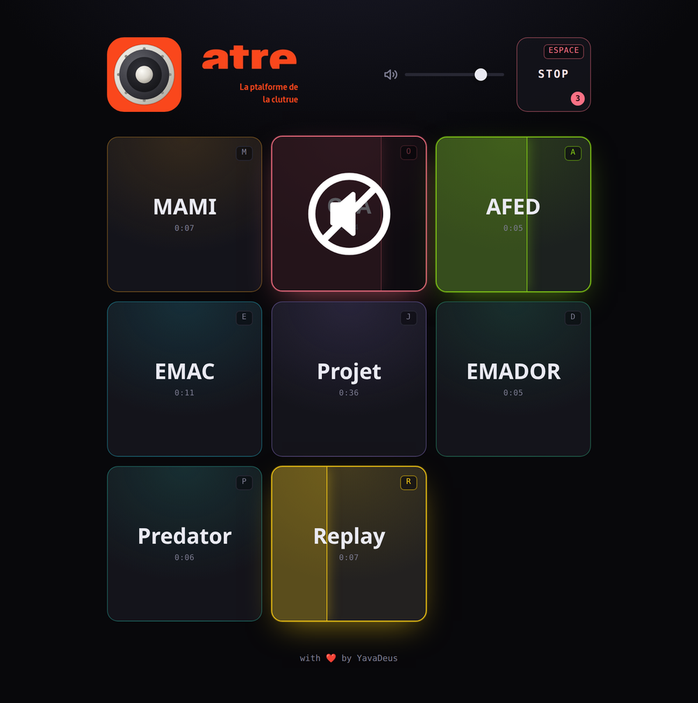

<div align="center">


# atre-soundboard

**Une soundboard qui se joue au clavier, et qui montre ce qu'elle joue.**

Grille de pads, un son par pad. Clique, tape la touche, ou touche l'écran.
Le pad se remplit de sa couleur pendant toute la durée de l'échantillon.
100% front-end, zéro backend, zéro dépendance en dehors de React.

**[atre-soundboard.vercel.app](https://atre-soundboard.vercel.app)**

</div>

<div align="center">



</div>

---

## Ce que ça fait

- **Déclenchement instantané.** Les échantillons sont décodés une fois en mémoire
  via la Web Audio API, pas rejoués depuis une balise `<audio>`. Aucune latence
  entre l'appui et le son.
- **On voit le son jouer.** Flash à l'impact, puis le pad se remplit de gauche à
  droite pendant exactement la durée de l'échantillon. Animation CSS pure, donc
  huit pads peuvent jouer en même temps sans coûter une image par seconde.
- **Chaque pad est un interrupteur.** Un appui lance, un second coupe. Au survol
  d'un pad qui joue, une grosse icône de haut-parleur barré annonce la coupure.
- **Tout au clavier.** Une touche par pad (la première lettre de son label),
  `Espace` coupe tout.
- **Tactile de plain-pied.** Grille responsive, pads larges, raccourcis masqués
  sur mobile où ils ne servent à rien.
- **Accessible.** Chaque pad est un vrai bouton avec libellé et état
  `aria-pressed`, l'information n'est jamais portée par la seule couleur, et
  `prefers-reduced-motion` neutralise flash et remplissage.

## Démarrer

```bash
make install
make start
```

Le serveur de dev tourne sur http://localhost:5050.

## Ajouter un son

Trois étapes, et rien d'autre à toucher :

```bash
cp mon-son.wav sounds/src/    # n'importe quel format lu par ffmpeg
make sounds                   # reencode en mp3 mono + regenere le manifest
```

Puis ajuste `label`, `key` et `accent` dans [`src/sounds.json`](src/sounds.json) :

```json
{ "id": "mami", "label": "MAMI", "file": "sounds/mami.mp3", "duration": 7.18, "key": "m", "accent": "#f5a524" }
```

`make sounds` **préserve** les labels, touches, couleurs et l'ordre des entrées
existantes (l'ordre du manifest est l'ordre de la grille) et n'attribue des
valeurs par défaut qu'aux nouveaux sons. Il est idempotent : le relancer sans
rien changer laisse le fichier au caractère près.

Le manifest est validé au démarrage : identifiant ou touche en double, couleur
hors format hexadécimal, durée non positive, et l'application refuse de
démarrer. Un manifest cassé doit se voir tout de suite plutôt que produire un
pad muet.

## Pourquoi tout est réencodé en mp3 mono

Safari et iOS ne lisent ni l'Ogg Vorbis ni le WebM. `make sounds` passe donc
tout en mp3 mono 44,1 kHz, ce qui règle la compatibilité et divise le poids par
deux sur des échantillons de voix. Les fichiers d'origine restent dans
`sounds/src/`, qui est la source de vérité ; `public/sounds/` est généré, mais
versionné, parce que Vercel n'a pas ffmpeg au build.

## Stack

React 19 + TypeScript, Vite, Tailwind CSS v4, Web Audio API, Vitest.
Aucune dépendance runtime en dehors de React.

## Commandes

| Commande | Effet |
|---|---|
| `make install` | Installe les dépendances |
| `make start` | Serveur de dev (http://localhost:5050) |
| `make build` | Build de production |
| `make sounds` | Réencode les sons et régénère le manifest |
| `make og` | Régénère la carte Open Graph et l'icône iOS |
| `make test` | Tests unitaires et composants |
| `make lint` | ESLint |
| `make typecheck` | Vérifie les types |
| `make knip` | Détecte fichiers / exports / dépendances inutilisés |
| `make fix` | Format + lint |
| `make check` | build + lint + typecheck + knip + tests |

## Déploiement

Site statique, aucune Function, aucune base, aucun secret. Sur Vercel il n'y a
rien à configurer au-delà du framework détecté automatiquement.

La production tourne sur
[atre-soundboard.vercel.app](https://atre-soundboard.vercel.app). Cette origine
est le défaut au build, et sert à construire l'URL canonique, l'image Open Graph
et les données structurées. Pour déployer ailleurs, deux échappatoires, dans cet
ordre de priorité : la variable `SITE_URL`, sinon
`VERCEL_PROJECT_PRODUCTION_URL` que Vercel fournit automatiquement. Penser dans
ce cas à `public/robots.txt` et `public/sitemap.xml`, qui portent l'URL en dur.

## Documentation

[AGENTS.md](AGENTS.md) détaille l'architecture, les pièges du moteur audio
(politique d'autoplay, course au premier déclenchement, cycle de vie du contexte)
et les conventions du dépôt.

## Licence

[MIT](LICENSE) - YavaDeus
